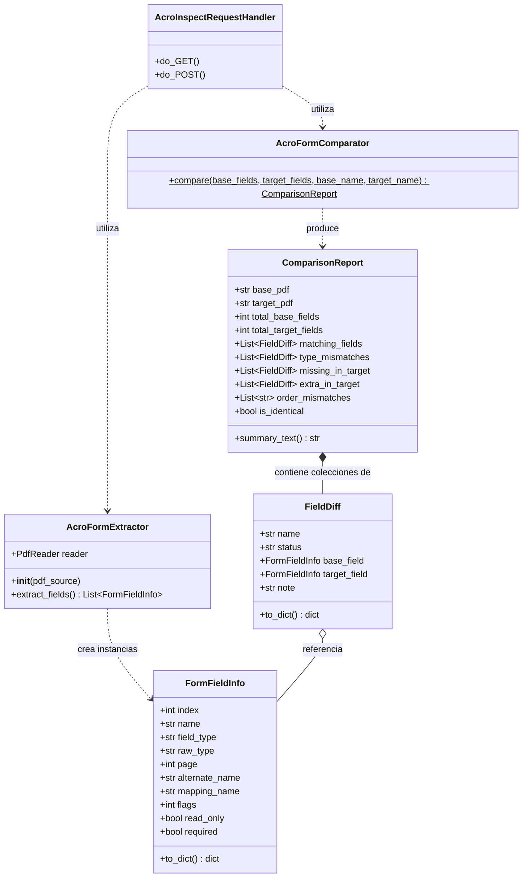
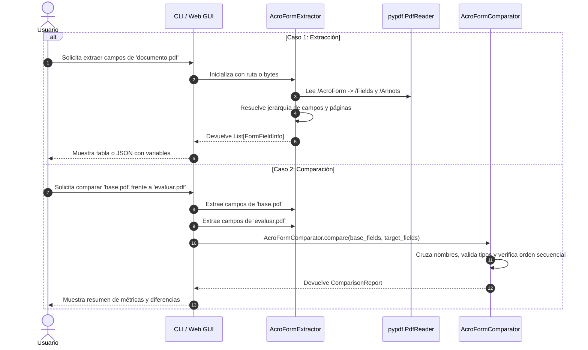

# Manual Técnico del Proyecto: AcroInspect

**AcroInspect** es una biblioteca y herramienta en Python (CLI e interfaz Web) diseñada para la inspección, extracción secuencial y comparación estructural de formularios interactivos **AcroForm** contenidos en documentos PDF.

---

## 1. Estructura General del Proyecto

```
AcroInspect/
│
├── acroinspect/                   # Paquete principal
│   ├── __init__.py                # Exportación del API pública
│   ├── extractor.py               # Extracción y parsing del árbol AcroForm
│   ├── comparator.py              # Lógica de comparación de esquemas y tipos
│   ├── cli.py                     # Interfaz de línea de comandos (argparse)
│   └── app_gui.py                 # Servidor HTTP y SPA web interactiva
│
├── tests/                         # Pruebas unitarias
│   └── test_acroinspect.py
│
├── examples/                      # Generador y muestras de prueba
│   └── generate_samples.py
│
├── main.py                        # Punto de entrada ejecutable
├── MANUAL_TECNICO.md              # Este manual técnico
├── README.md                      # Documentación rápida y guía de uso
└── requirements.txt               # Dependencias del proyecto
```

---

## 2. Diagrama de Arquitectura y Clases



---

## 3. Módulos, Clases y Métodos en Detalle

### 3.1. Módulo `acroinspect.extractor`

Encargado de interactuar con la estructura binaria y diccionarios del PDF usando `pypdf`, procesar el catálogo raíz (`/Root` -> `/AcroForm` -> `/Fields`) y resolver referencias indirectas, jerarquías de campos (`/Kids`) y correspondencia con páginas físicas.

#### 📌 Clase `FormFieldInfo`
*Data class* (`@dataclass`) que modela los metadatos y propiedades de una variable o campo del formulario.

* **Atributos**:
  * `index: int`: Posición numérica secuencial (1-based) en el orden en que fue procesado en el PDF.
  * `name: str`: Nombre cualificado de la variable (soporta jerarquías compuestas con notación por puntos: `Cliente.Direccion.Ciudad`).
  * `field_type: str`: Tipo legible resuelto por flags y diccionario (ej: `"Text"`, `"Text (Multiline)"`, `"Text (Password)"`, `"Checkbox"`, `"Radio"`, `"Dropdown"`, `"ListBox"`, `"PushButton"`, `"Signature"`).
  * `raw_type: str`: Código original según la especificación PDF (`"/Tx"`, `"/Btn"`, `"/Ch"`, `"/Sig"` o `"Unknown"`).
  * `page: Optional[int]`: Número de página física en la que se ubica el campo (1-based), resuelto cruzando anotaciones con widgets.
  * `alternate_name: Optional[str]`: Descripción alternativa o tooltip del campo (`/TU`).
  * `mapping_name: Optional[str]`: Nombre de mapeo o exportación hacia bases de datos externas (`/TM`).
  * `flags: int`: Máscara de bits de características del campo (`/Ff`).
  * `read_only: bool`: Indicador booleano de campo solo lectura (Bit 1 de `/Ff`).
  * `required: bool`: Indicador booleano de campo obligatorio (Bit 2 de `/Ff`).

* **Métodos**:
  * `to_dict() -> Dict[str, Any]`: Convierte el objeto a un diccionario estándar para exportación a JSON o consumo de API.

---

#### 📌 Clase `AcroFormExtractor`
Motor extractor que procesa un documento PDF y genera la lista de `FormFieldInfo`.

* **Constructor**:
  * `__init__(pdf_source: Union[str, Path, bytes, pypdf.PdfReader])`:
    * Admite una ruta de archivo (`str` o `Path`), bytes en memoria (`bytes` o `io.BytesIO`) o una instancia ya creada de `pypdf.PdfReader`.
    * Inicializa el lector interno `self.reader`.

* **Métodos Públicos**:
  * `extract_fields() -> List[FormFieldInfo]`:
    * Extrae la lista ordenada de campos preservando la secuencia de navegación del formulario.
    * Resuelve las asociaciones de página examinando `/Annots` en cada página del documento.
    * Devuelve `List[FormFieldInfo]`.

* **Lógica Interna y Métodos Privados**:
  * `resolve_obj(obj: Any) -> Any`: Resuelve referencias indirectas (`IndirectObject`) extrayendo el objeto real.
  * `determine_field_type(raw_ft: Optional[str], flags: int, dict_obj: Dict[str, Any]) -> str`:
    * Interpreta el tipo crudo (`/FT`) y los bits de `/Ff`:
      * `/Tx` (Texto): evalúa bit 21 (password) y bit 13 (multilínea).
      * `/Btn` (Botón): bit 17 (pushbutton), bit 16 (radio) o checkbox por defecto.
      * `/Ch` (Opción): bit 18 (dropdown/combo) o listbox.
      * `/Sig` (Firma digital).
  * `traverse_node(node_ref, inherited_name, inherited_ft, inherited_flags)`:
    * Función recursiva que navega el árbol de campos (`/Fields` y `/Kids`).
    * Distingue entre campos intermedios (nodos padre) y campos terminales con representaciones gráficas (widgets asociados).
    * Acumula nombres jerárquicos y herencia de tipos.

---

### 3.2. Módulo `acroinspect.comparator`

Proporciona la lógica para cotejar dos estructuras de formularios AcroForm, determinando similitudes, diferencias de tipo, faltantes, extras y desórdenes secuenciales.

#### 📌 Clase `FieldDiff`
Representa el resultado del análisis sobre una variable en particular.

* **Atributos**:
  * `name: str`: Nombre del campo analizado.
  * `status: str`: Estado de la comparación:
    * `'MATCH'`: Coincidencia exacta de nombre y tipo.
    * `'TYPE_MISMATCH'`: Mismo nombre pero tipos incompatibles.
    * `'MISSING_IN_TARGET'`: Presente en PDF base pero ausente en el segundo PDF.
    * `'EXTRA_IN_TARGET'`: Presente en el segundo PDF pero ausente en el PDF base.
  * `base_field: Optional[FormFieldInfo]`: Información del campo en el PDF base.
  * `target_field: Optional[FormFieldInfo]`: Información del campo en el PDF evaluado.
  * `note: str`: Explicación detallada del estado.

* **Métodos**:
  * `to_dict() -> Dict[str, Any]`: Serializa el diff a diccionario nativo.

---

#### 📌 Clase `ComparisonReport`
Contenedor con el informe consolidado de la comparación.

* **Atributos**:
  * `base_pdf: str`: Nombre del PDF base.
  * `target_pdf: str`: Nombre del PDF evaluado.
  * `total_base_fields: int`: Total de variables del PDF base.
  * `total_target_fields: int`: Total de variables del PDF evaluado.
  * `matching_fields: List[FieldDiff]`: Lista de campos coincidentes.
  * `type_mismatches: List[FieldDiff]`: Lista de discrepancias de tipo.
  * `missing_in_target: List[FieldDiff]`: Variables faltantes.
  * `extra_in_target: List[FieldDiff]`: Variables adicionales.
  * `order_mismatches: List[str]`: Avisos de alteraciones en el orden relativo de campos comunes.

* **Propiedades y Métodos**:
  * `@property is_identical -> bool`: Retorna `True` si ambos documentos son 100% idénticos en variables y tipos (sin faltantes, extras ni discrepancias).
  * `summary_text() -> str`: Genera un reporte formateado en texto con marcos y símbolos listo para imprimir en consola.

---

#### 📌 Clase `AcroFormComparator`
Clase utilitaria con métodos estáticos para ejecutar el cotejo.

* **Métodos**:
  * `compare(base_fields: List[FormFieldInfo], target_fields: List[FormFieldInfo], base_name: str = "PDF_1", target_name: str = "PDF_2") -> ComparisonReport`:
    * Cruza los campos de ambos formularios utilizando sus nombres como identificador.
    * Realiza la comprobación de tipo y genera las listas de coincidencias, discrepancias, faltantes y extras.
    * Compara las listas de nombres comunes para verificar si el orden de los campos se mantiene entre ambos documentos.

---

### 3.3. Módulo `acroinspect.cli`

Implementa los comandos de terminal usando la librería estándar `argparse`.

* **Funciones**:
  * `format_table(fields: List[FormFieldInfo]) -> str`: Construye una tabla ASCII dinámica adaptando el ancho de columnas según el contenido.
  * `run_extract(pdf_path: str, as_json: bool = False)`: Ejecuta la extracción de un PDF y la imprime en tabla o JSON.
  * `run_compare(base_pdf: str, target_pdf: str, as_json: bool = False)`: Ejecuta la comparación entre dos PDFs e imprime el reporte en texto o JSON.
  * `main()`: Configura el parser de argumentos con los subcomandos `extract`, `compare` y `ui`/`gui`.

---

### 3.4. Módulo `acroinspect.app_gui`

Servidor web local e interfaz gráfica responsiva en navegador web sin necesidad de frameworks de terceros como Flask o Node.js.

* **Clase `AcroInspectRequestHandler(http.server.BaseHTTPRequestHandler)`**:
  * `do_GET()`: Sirve la aplicación de una sola página (SPA) definida en `HTML_CONTENT`.
  * `do_POST()`: Atiende los endpoints de la API:
    * `/api/extract`: Recibe PDF codificado en Base64, realiza la extracción en memoria y devuelve la lista de variables en JSON.
    * `/api/compare`: Recibe dos archivos PDF en Base64, realiza la comparación y devuelve el reporte completo en JSON.
  * `log_message(...)`: Silencia los logs de peticiones HTTP en consola para mantener limpia la salida.

* **Función `start_server(port: int = 8765, open_browser: bool = True)`**:
  * Levanta el servidor en `127.0.0.1:{port}`.
  * Utiliza `webbrowser.open` en un temporizador en segundo plano para abrir la aplicación automáticamente en el navegador.

---

## 4. Flujo de Ejecución del Sistema



---

## 5. Pruebas Unitarias

Ubicadas en `tests/test_acroinspect.py`:
* **`test_extract_fields_basic`**: Verifica la correcta identificación de campos de texto, checkboxes, listas desplegables y sus flags.
* **`test_compare_identical`**: Verifica que dos archivos con la misma estructura arrojen `is_identical == True`.
* **`test_compare_mismatch_and_missing`**: Valida que se detecten discrepancias cuando un campo cambia de tipo o falta en el segundo PDF.
* **`test_order_mismatch`**: Comprueba la alerta cuando el orden de aparición de los campos comunes difiere entre documentos.
